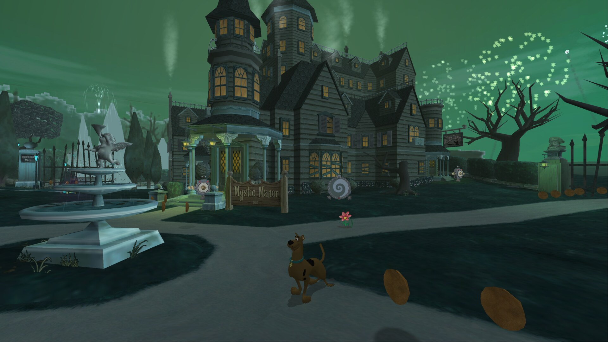
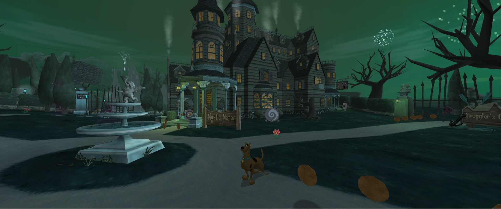
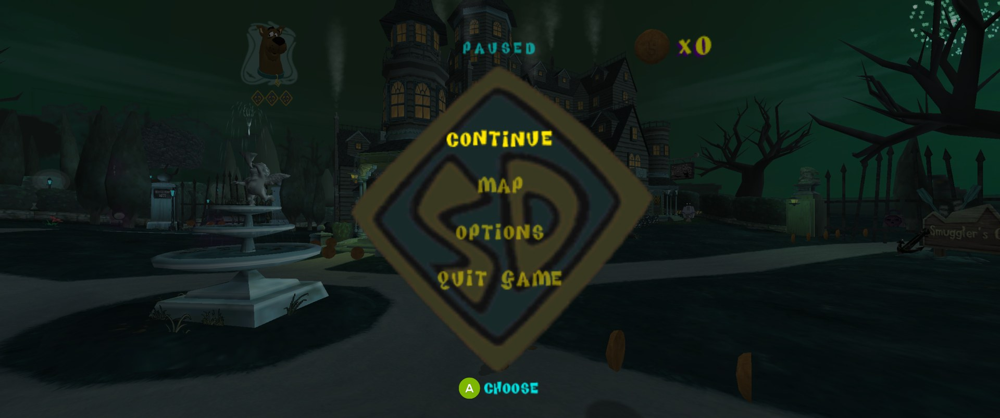
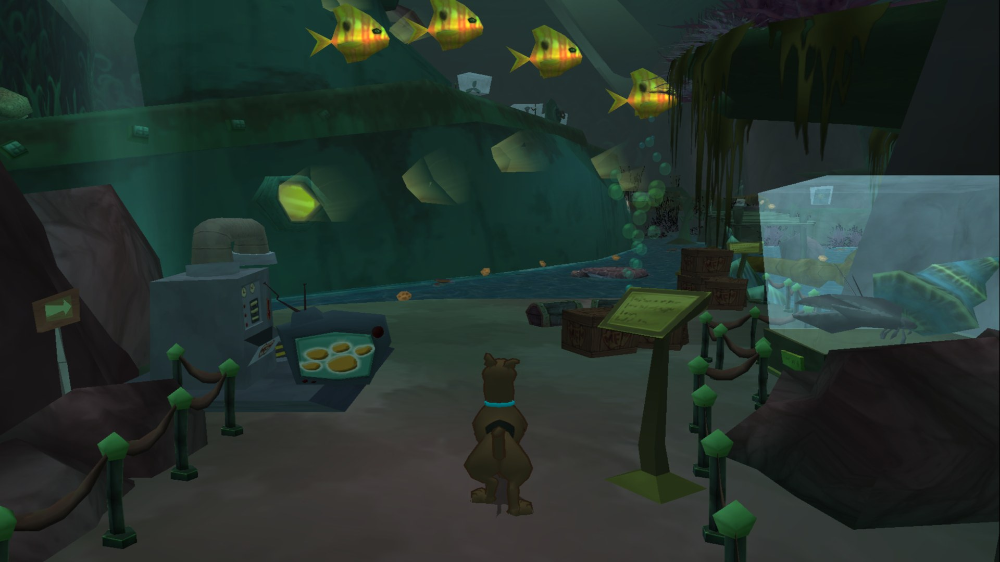
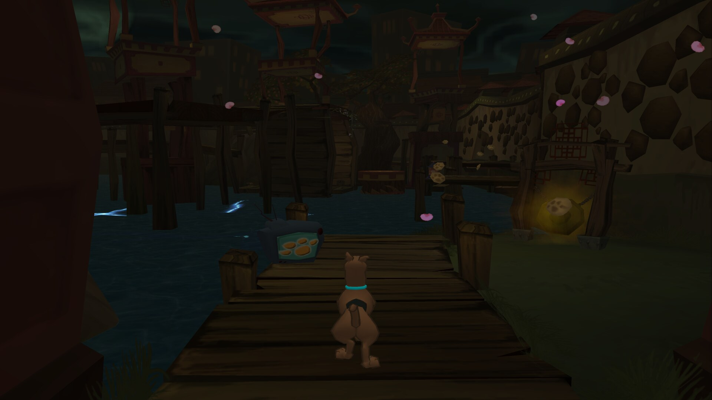
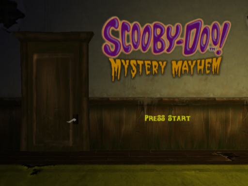

# 👻 FrightWorks

**Unofficial PC ports of Scooby-Doo! games.**

The GameCube originals, recompiled into native programs: no emulator in between, and no game data included.
Bring your own disc.

[**frightworks.dev**](https://frightworks.dev) ·
[Download](https://github.com/FrightWorks/FrightWorks-no100f/releases/latest) ·
[Report a bug](https://github.com/FrightWorks/FrightWorks-no100f/issues) ·
[Download stats](https://frightworks.dev/stats/) ·
[Credits](https://frightworks.dev/credits/)

## The games

| Game | Original | Status |
| --- | --- | --- |
| [**Night of 100 Frights**](https://frightworks.dev/games/no100f/) | GameCube · 2002 |  |
| [**Unmasked**](https://frightworks.dev/games/unmasked/) | GameCube · 2005 |  |
| [**Mystery Mayhem**](https://frightworks.dev/games/mystery-mayhem/) | GameCube · 2004 |  |

---

### Night of 100 Frights

The 2002 GameCube game, recompiled for Windows and Linux. Continues
[Scooby-Doo: Refrightened](https://github.com/josiahg2502-glitch/Scooby-Doo-Refrightened) by JosiahG.

  
  

- **Up to 4K** with MSAA, cartoon ink outlines and HDR
- **True widescreen**: 16:9, fill, cinematic 2.39:1, or the original 4:3
- **60 fps**, or the original 30
- **Built-in HD texture pack** by dogerki
- **Any gamepad**, with Xbox, PlayStation or Nintendo button prompts, plus optional original Xbox controls
- The Xbox edition's Creeper window animation, back in Mystic Manor's courtyard
- Mods, memory-card saves, holiday events, and automatic updates for the installed version

**You need:** Windows 10 or 11 (64-bit), or x86_64 Linux for the beta, and your own copy of the GameCube USA disc,
v1.01 (GIHE78, revision 1), as `.iso`, `.gcm` or `.ciso`.

[**⬇ Windows installer**](https://github.com/FrightWorks/FrightWorks-no100f/releases/latest/download/FrightWorks-win-Setup.exe) ·
[**⬇ Linux AppImage (beta)**](https://github.com/FrightWorks/FrightWorks-no100f/releases/latest/download/FrightWorks.AppImage) ·
[All downloads](https://github.com/FrightWorks/FrightWorks-no100f/releases/latest) ·
[Game page and FAQ](https://frightworks.dev/games/no100f/) ·
[Source](https://github.com/FrightWorks/FrightWorks-no100f)

### Unmasked: coming soon

The 2005 GameCube game, recompiled for Windows, made the same way as Night of 100 Frights. In the works: up to 4K,
widescreen up to 2.39:1, 120 or 180 fps with frame interpolation, HDR, and gamepads with matching button prompts.
You'll need your own copy of the GameCube USA disc (G5DE78).

  
  

Work in progress: screenshots from the port as of October 2026.
[More on the game page](https://frightworks.dev/games/unmasked/).

### Mystery Mayhem: planned

A port of the 2004 GameCube game is planned after Unmasked. In the original, someone has freed thousands of ghosts and
monsters from a magic book, the Tome of Doom, and Scooby and Shaggy have to catch them again across five locations, from
Hambridge Library to a bayou.

Details will appear on [the game page](https://frightworks.dev/games/mystery-mayhem/) once work starts.

 

---

## How it works

Each game's PowerPC code is translated ahead of time to C++ with [WiiCompiled](https://github.com/patchzyy/Wiicompiled)
and compiled into a native program. There's no CPU emulator: the console's graphics, audio and system calls are
reimplemented underneath. Your disc image supplies the game's data, so none of it is in our repositories or downloads.

## Repositories

| Repository | What it is |
| --- | --- |
| [FrightWorks-no100f](https://github.com/FrightWorks/FrightWorks-no100f) | The Night of 100 Frights port and its launcher |
| [FrightWorks-site](https://github.com/FrightWorks/FrightWorks-site) | Source of [frightworks.dev](https://frightworks.dev) |
| [download-stats](https://github.com/FrightWorks/download-stats) | Download counts per file and version, shown at [frightworks.dev/stats](https://frightworks.dev/stats/) |

## Get involved

- 🎨 **Wanted: a launcher artist.** The launcher's haunted-mansion art is a placeholder, and we'd like it redrawn in
  the style of the original show. [What's needed](https://github.com/FrightWorks/FrightWorks-no100f#wanted-an-artist-for-the-launcher).
- 🐧 **Trying the Linux beta?** Tell us how it runs on your setup in the
  [issue tracker](https://github.com/FrightWorks/FrightWorks-no100f/issues).
- 🐛 **Found a bug?** [Open an issue](https://github.com/FrightWorks/FrightWorks-no100f/issues) and say what happened.

---

Unofficial fan project. Scooby-Doo ™ & © Hanna-Barbera / Warner Bros. Night of 100 Frights © THQ / Warner Bros.
Interactive, developed by Heavy Iron Studios. Unmasked and Mystery Mayhem © THQ / Warner Bros. Interactive, developed by
Artificial Mind and Movement. Not affiliated with or endorsed by them. No game data is included in any FrightWorks
download. The Mystery Mayhem title screen is from
[libretro-thumbnails](https://github.com/libretro-thumbnails/Nintendo_-_GameCube), shown for identification; it remains
the property of its owners.
